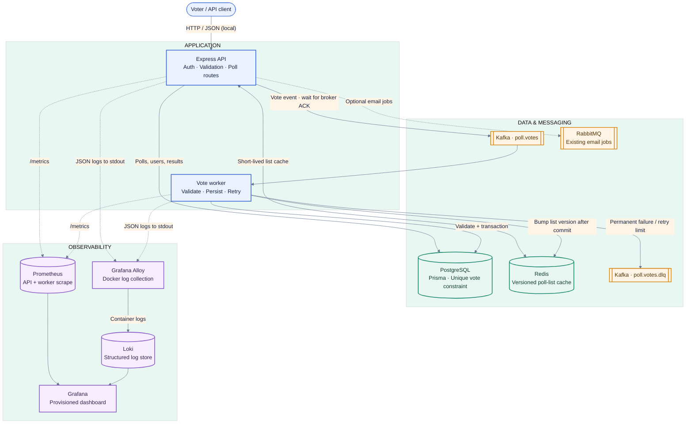
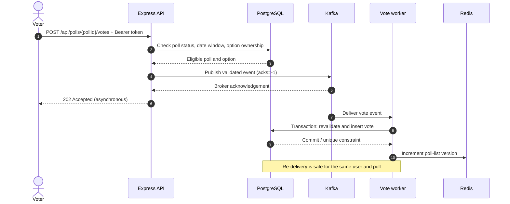
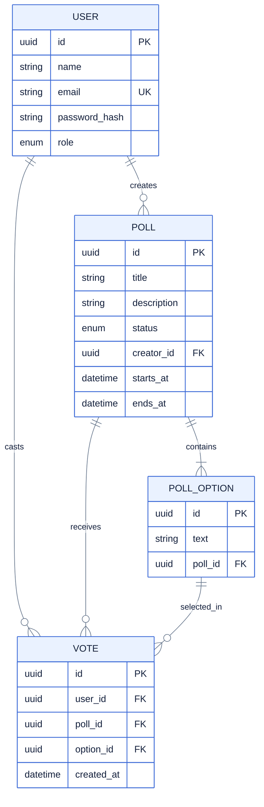

<div align="center">

# PlusePoll

### Real-time polling API with asynchronous, idempotent vote processing

An event-driven backend built with **Express**, **PostgreSQL**, **Prisma**, **Kafka**, and **Redis**. Vote requests are acknowledged by Kafka and persisted by a separate worker; operational metrics and container logs are exposed through a provisioned Prometheus, Grafana, and Loki stack.

[](https://developer.mozilla.org/en-US/docs/Web/JavaScript)
[](https://nodejs.org/)
[](https://expressjs.com/)
[](https://www.postgresql.org/)
[](https://www.prisma.io/)
[](https://redis.io/)
[](https://kafka.apache.org/)
[](https://www.rabbitmq.com/)
[](https://www.docker.com/)
[](https://prometheus.io/)
[](https://grafana.com/)
[](https://grafana.com/oss/loki/)

</div>

---

## Project overview

PlusePoll is a portfolio-scale backend project focused on API design and reliable asynchronous work. It combines poll management, token-based authentication, a relational data model, event-driven vote processing, short-lived caching, and an observability stack that runs locally with Docker Compose.

The core engineering decision is to keep the HTTP request path separate from vote persistence:

1. The API authenticates the voter and checks poll availability and option ownership.
2. The API publishes a validated vote event and responds `202 Accepted` after Kafka acknowledges it.
3. A dedicated consumer validates the event again and persists the vote transactionally.
4. PostgreSQL's unique constraint prevents the same user from voting twice in a poll.
5. After persistence, the worker invalidates poll-list cache versions.

> **Scope note:** This is a local-development and learning project, not a claim of production readiness or a throughput benchmark. Known limitations and delivery semantics are documented below.

## What this project demonstrates

- **API design:** Express routes for registration, login, poll creation, poll discovery, results, voting, health, readiness, and metrics.
- **Asynchronous architecture:** Kafka producer and independently runnable consumer, with a vote dead-letter topic.
- **Data integrity:** Prisma models, relational constraints, and database-enforced duplicate-vote protection.
- **Resilience patterns:** bounded input validation, fallback to PostgreSQL when Redis caching is unavailable, transient retry handling, and graceful shutdown.
- **Observability:** structured JSON logs, Prometheus counters and histograms, provisioned Grafana data sources/dashboard, and Loki ingestion through Grafana Alloy.
- **Local infrastructure:** pinned service images, health checks, named data volumes, migrations, and Docker Compose startup dependencies.
- **Verification:** Node's built-in test runner, Prisma schema validation, Docker Compose validation, and observability configuration checks.

## Technology

| Area | Technology | Role |
|---|---|---|
| Runtime and language | Node.js 22, JavaScript ES modules | API and worker runtime |
| HTTP API | Express 5 | Routing, middleware, and JSON endpoints |
| Authentication | JSON Web Tokens, bcrypt | Bearer-token authentication and password hashing |
| Database | PostgreSQL 16, Prisma ORM | Poll, option, user, and vote persistence |
| Cache | Redis 7 | Versioned, short-TTL poll-list caching |
| Event streaming | Apache Kafka 3.9, KafkaJS | Asynchronous vote events and dead-letter topic |
| Existing email queue | RabbitMQ 4.1, amqplib | Separate email-job integration; not part of vote processing |
| Logs | Pino, Grafana Alloy, Loki | Structured application logs and container log collection |
| Metrics and dashboards | prom-client, Prometheus, Grafana | Runtime/API/worker metrics and operations dashboard |
| Local environment | Docker, Docker Compose | Reproducible development services |
| Load-test examples | k6 | Listing and vote-submission smoke scenarios |

## Architecture

The diagram distinguishes the synchronous HTTP request path from asynchronous persistence and telemetry. Application and worker processes emit metrics independently; Prometheus scrapes both endpoints.



### Vote request sequence



## Key engineering decisions

### Asynchronous votes and delivery guarantees

Kafka and PostgreSQL do not share an atomic transaction. This implementation therefore does **not** claim exactly-once processing. Vote persistence is designed for **at-least-once delivery**:

- The worker completes the database transaction before Kafka can consider the message handled.
- The database unique constraint on `(user_id, poll_id)` is the final defense against duplicate votes.
- A repeated vote is handled as a duplicate rather than a consumer crash.
- Permanently invalid events are sent to `poll.votes.dlq` with the original payload and a safe failure reason.
- Transient persistence failures are retried up to three times per worker process before dead-lettering. Attempts are process-local, so repeated restarts can extend retries.
- If dead-letter publication fails, the worker does not treat the original message as successfully handled.

### Cache behavior

- Only poll-list responses are cached; user-specific or secret data is not cached.
- Cache keys include a version plus pagination parameters, and entries use a configurable short TTL.
- Identical concurrent list requests in one API process share the same in-flight database query.
- The vote worker increments the cache version only after the vote transaction commits.
- An unavailable Redis cache falls back to PostgreSQL.

### Logging and metrics

- Pino emits structured logs to stdout. Request logs include a correlation ID, normalized route, status, and duration; credentials and authorization headers are redacted.
- Prometheus labels use bounded route templates and omit user IDs, poll IDs, tokens, and event IDs.
- Grafana Alloy collects Docker logs through the Docker Engine API and forwards them to Loki.
- Prometheus scrapes both API and worker metrics endpoints.

## API reference

The canonical poll routes are under `/api/polls`; `/poll` routes remain available for compatibility.

| Method | Endpoint | Auth | Description |
|---|---|---:|---|
| `POST` | `/auth/register` | No | Register and return an access token |
| `POST` | `/auth/login` | No | Authenticate and return an access token |
| `GET` | `/auth/health` | No | Authentication-route health check |
| `POST` | `/api/polls` | Bearer | Create a draft poll and its options |
| `GET` | `/api/polls?page=1&limit=5` | No | Paginated active polls |
| `GET` | `/api/polls/:pollId` | No | Poll details and option vote counts |
| `POST` | `/api/polls/:pollId/votes` | Bearer | Submit an asynchronous vote |
| `GET` | `/health` | No | Process liveness |
| `GET` | `/ready` | No | PostgreSQL, Redis, and Kafka readiness |
| `GET` | `/metrics` | No | Prometheus metrics exposition |

### Create a poll

Polls follow the current Prisma schema's initial `DRAFT` status. The request accepts `question` (or legacy `title`) and at least two unique, non-empty options.

```http
POST /api/polls
Authorization: Bearer <access-token>
Content-Type: application/json

{
  "question": "Which feature should we build next?",
  "options": ["Mobile app", "Team workspaces", "Poll analytics"]
}
```

### List polls

```http
GET /api/polls?page=1&limit=5
```

Only polls with `ACTIVE` status and within their configured opening/closing dates are listed. `limit` defaults to 5 and has a maximum of 50.

### Cast a vote

```http
POST /api/polls/<poll-id>/votes
Authorization: Bearer <access-token>
Content-Type: application/json

{
  "optionId": "<option-id>"
}
```

`202 Accepted` means Kafka acknowledged the vote event. Persistence is asynchronous, so the result count may not change immediately. `409 Conflict` can indicate the user has already voted or voting is not open.

> **Local demo note:** poll creation intentionally follows the schema and creates `DRAFT` polls. For a local test, activate a poll in the development database before submitting a vote:
>
> ```sql
> UPDATE polls SET status = 'ACTIVE' WHERE id = '<poll-id>';
> ```

### Authentication example

Registration and login return a bearer token in the response `data` object:

```http
POST /auth/register
Content-Type: application/json

{
  "name": "Example User",
  "email": "user@example.test",
  "password": "use-a-unique-local-password"
}
```

```powershell
curl.exe -X POST http://localhost:5000/auth/login `
  -H "Content-Type: application/json" `
  -d '{ "email": "user@example.test", "password": "use-a-unique-local-password" }'
```

## Run locally

### Prerequisites

- Docker Desktop with Docker Compose
- Node.js 22+ and npm (for running tests or running the application directly)
- Optional: k6 for load-test examples

### Docker Compose (recommended)

1. Create `.env` from `.env.example` if there is no existing file. If you already have `.env`, **merge in missing values** rather than replacing your existing connection settings.
2. Replace placeholder passwords and generate a strong random `JWT_SECRET`. For example:

   ```powershell
   node -e "console.log(require('crypto').randomBytes(32).toString('hex'))"
   ```

3. Start the development stack:

   ```powershell
   docker compose up --build -d
   ```

4. Check service status and application logs:

   ```powershell
   docker compose ps
   docker compose logs -f poll-api vote-worker
   ```

5. Stop services without deleting local database/metrics data:

   ```powershell
   docker compose down
   ```

Use `docker compose down -v` only when intentionally deleting **all named volumes and their data**.

Compose starts PostgreSQL, Redis, RabbitMQ, Kafka in single-node KRaft mode, initializes vote topics, applies committed Prisma migrations, and starts the API and worker. Health and completion conditions gate dependent services. Host clients connect to Kafka at `localhost:9094`; Docker services use `kafka:9092`.

### Run Node processes on the host

Start the required backing services first, and configure `.env` to use host addresses (for example `localhost`). Then:

```powershell
npm ci
npx prisma migrate deploy
npm start
```

In another terminal, start the vote worker:

```powershell
npm run start:worker
```

For API hot reload during development:

```powershell
npm run dev
```

### Environment variables

See [.env.example](./.env.example). Important values:

| Variable | Purpose |
|---|---|
| `DATABASE_URL` | PostgreSQL connection string |
| `JWT_SECRET` | JWT signing secret; required by the API |
| `REDIS_URL` | Redis connection string |
| `KAFKA_BROKERS` | Kafka broker list; Docker clients use `kafka:9092` |
| `KAFKA_VOTE_TOPIC` | Vote event topic (default `poll.votes`) |
| `KAFKA_VOTE_DLQ_TOPIC` | Dead-letter topic (default `poll.votes.dlq`) |
| `KAFKA_VOTE_GROUP_ID` | Consumer group name |
| `POLL_CACHE_TTL_SECONDS` | Poll-list cache TTL, clamped to 1–120 seconds |
| `RABBITMQ_URL` | Existing optional email-queue broker |
| `GRAFANA_ADMIN_USER` / `GRAFANA_ADMIN_PASSWORD` | Local Grafana sign-in |

Use URL-encoded credentials if passwords contain reserved characters in a connection URL. Never commit `.env` or use example credentials outside a local environment.

## Observability

| Component | Local URL | What to inspect |
|---|---|---|
| API liveness | [localhost:5000/health](http://localhost:5000/health) | Is the API process responding? |
| API readiness | [localhost:5000/ready](http://localhost:5000/ready) | Are required dependencies available? |
| API metrics | [localhost:5000/metrics](http://localhost:5000/metrics) | HTTP, cache, database, and runtime metrics |
| Prometheus | [localhost:9090](http://localhost:9090) | Query metrics; **Status → Targets** should show API and worker `UP` |
| Grafana | [localhost:3001](http://localhost:3001) | Sign in with `.env` credentials; open **PlusePoll Operations** |
| RabbitMQ management | [localhost:15672](http://localhost:15672) | Inspect the existing email-job broker |

The provisioned Grafana dashboard uses real application metrics for HTTP request rate/errors/latency, process CPU and memory, Kafka processing/failures/DLQ, cache hit ratio, PostgreSQL errors, and application error logs.

In Grafana **Explore**, select Loki and try:

```logql
{service=~".*(poll-api|vote-worker).*"}
```

Structured fields such as `level`, `requestId`, and `eventId` are log fields, not Loki stream labels. Alloy uses the Docker Engine API rather than assuming a particular host log-file path. **The Docker socket grants powerful host access**; use this collector only in a trusted local development environment.

If a Prometheus target is down, check `docker compose ps`, container health, `docker compose logs poll-api vote-worker prometheus`, and the service name/port in `observability/prometheus/prometheus.yml`.

## Database and migrations

The schema includes `User`, `Poll`, `PollOption`, and `Vote`, plus enums for user role and poll status. The initial committed migration already defines a unique constraint on `(user_id, poll_id)`, so no destructive schema change was needed.



The database enforces one vote per user per poll with a unique `(user_id, poll_id)` constraint. The API checks eligibility before publishing, and the consumer repeats the poll and option checks before writing.

Apply committed migrations to an existing database with:

```powershell
npx prisma migrate deploy
```

Do not reset a database containing data you need to keep.

## Tests and load-test examples

Run the automated tests:

```powershell
npm test
```

The current Node test suite covers poll-input validation, poll eligibility dates/status, vote-event validation, health and metrics endpoints, unauthenticated voting, and invalid pagination. It does **not** yet include live PostgreSQL, Redis, or Kafka integration tests.

The k6 scripts are small smoke/load examples, not performance guarantees. Install k6 separately and run:

```powershell
k6 run -e BASE_URL=http://localhost:5000 .\k6\poll-list.js
k6 run -e BASE_URL=http://localhost:5000 `
  -e POLL_ID=<poll-id> `
  -e OPTION_ID=<option-id> `
  -e AUTH_TOKEN=<token> `
  .\k6\vote.js
```

Supply test tokens through environment variables; do not put credentials into scripts or source control. The vote script allows asynchronous acceptance and duplicate responses and does not assume immediate result updates.

## Repository map

```text
src/
  config/          Redis, RabbitMQ, logging, metrics
  controller/      Authentication and poll business logic
  kafka/           Vote event validation and Kafka producer
  lib/             Prisma client initialization
  middlewares/     Authentication and rate limiting
  routes/          Express route definitions
  worker/          Independently runnable Kafka vote consumer
prisma/
  migrations/      Committed PostgreSQL schema migration
  schema.prisma    User, poll, option, and vote models
observability/
  alloy/           Docker log collection pipeline
  grafana/         Provisioned data sources and dashboard
  loki/            Local log storage configuration
  prometheus/      API and worker scrape targets
k6/                Listing and vote load-test scenarios
tests/             Unit and HTTP smoke tests
docker-compose.yml Local development infrastructure
```

## Known limitations and next steps

- The Compose deployment is a **single-node local-development setup**. Kafka uses plaintext; services do not provide production TLS/SASL or redundant brokers/databases.
- Protect Grafana, Prometheus, metrics, and management endpoints appropriately before any public deployment.
- Production hardening still needs secrets management, database/broker backups and redundancy, alerting, rate-limit strategy review, and service-backed integration testing.
- Password reset is not implemented and returns `501`.
- RabbitMQ email queueing is separate from voting; no production mail provider is integrated.
- Transient vote retry counts are held in worker-process memory; repeated worker restarts can extend retries.
- No benchmark has been run, so no requests-per-second or user-capacity claim is made.

## License

No license file is currently included. Add a license before redistributing this project.
